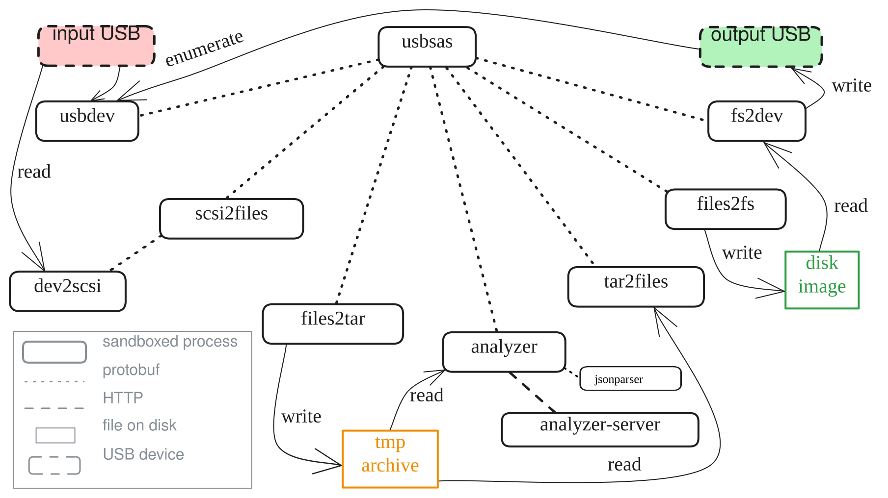

# usbsas architecture

* [Overview](#overview)
* [Components](#components)
* [Processes](#processes)
* [A transfer step by step](#transfer)
* [Communication](#communication)
* [Threat model](#threatmodel)
* [Sandboxing](#sandboxing)

## <a name="overview">Overview</a>

usbsas reads untrusted USB mass storage devices without letting the kernel
parse them. On a standard Linux system, plugging a USB key makes the kernel
parse its USB descriptors, talk SCSI to it (`usb_storage`, `uas`), read its
partition table and mount its file system, all with kernel privileges. A bug
in any of these layers can be exploited by a malicious device.

usbsas moves this work to user space and splits it in small processes
(microkernel style), each dedicated to one task and confined by its own
[seccomp](https://man7.org/linux/man-pages/man2/seccomp.2.html) filter, and by
[landlock](https://docs.kernel.org/userspace-api/landlock.html) where seccomp
isn't enough. A process parsing untrusted data can only talk to its parent
through two pipes: if it's compromised, the attacker is stuck in a process that
can't open files, connect to the network or execute anything.

Here are the processes running during a USB to USB file transfer:

## <a name="components">Components</a>

| Component | Crate | Role |
|-----------|-------|------|
| usbsas server | `usbsas-usbsas` | Orchestrator, spawns and drives every other usbsas process. Applications talk to it, never to devices. |
| Graphical client | `usbsas-client` | Full screen interface for end users, talks to the server over a Unix socket. |
| HID driver | `usbsas-hid` | Minimal user space mouse / touch screen driver, so the kernel HID drivers (and keyboards) can be disabled. |
| Analyzer server | `usbsas-analyzer-server` | Reference (demo) remote server: ClamAV analysis, upload and download of archives. |
| Tools | `usbsas-tools` | Standalone tools built from usbsas processes (mount, imager, port monitor...). |
| Python module | `python/` | Drives the server from Python scripts, an example of using usbsas as a framework. |

The other crates are the processes themselves (`usbsas-dev2scsi`,
`usbsas-scsi2files`...) and libraries shared by them: protocol definitions
(`usbsas-proto`), communication (`usbsas-comm`), process spawning
(`usbsas-process`), sandboxing (`usbsas-sandbox`), file systems (`usbsas-fsrw`),
SCSI and USB mass storage (`usbsas-scsi`, `usbsas-mass-storage`), configuration
(`usbsas-config`). Each crate has a README describing it in more detail.

## <a name="processes">Processes</a>

Every process is a state machine, going from an `init` state to an `end` state
depending on the requests received from its parent. When `end` is reached, the
process exits.

The server handles a **single session** (one transfer, wipe or disk image) and
then exits with all its children. It's restarted by systemd for the next
session, so no state (and no compromised process) survives from one session to
the next.

| Process | Role |
|---------|------|
| `usbsas` | Orchestrator, serves requests of the client (GUI, Python...)
| `usbdev` | Lists plugged USB mass storage devices (udev events and sysfs), assigns them a source or destination role depending on the USB port
| `identifier` | Gets the id of the user (placeholder, see [configuration](./configuration.md#identifier))
| `dev2scsi` | Opens the source device with libusb and speaks USB mass storage / SCSI to it. **Only process that reads the source device.**
| `scsi2files` | Parses the partition table and the file system of the source, from sectors read by `dev2scsi` (FAT, exFAT, NTFS, ext4, ISO9660)
| `local2files` | Reads files from a local directory source
| `downloader` | Downloads an archive from a remote source
| `files2tar` | Writes the files read from the source in the session archive
| `tar2files` | Reads files back from the session archive
| `analyzer` | Sends the archive to the remote analyzer and gets its verdict
| `jsonparser` | Parses the JSON responses of the analyzer for it
| `files2fs` | Creates a new file system (FAT, exFAT or NTFS) in an image file and writes files in it
| `fs2dev` | Writes the file system image to the destination device, wipes devices. **Only process that writes to the destination device.**
| `uploader` | Uploads the archive to a remote destination
| `cmdexec` | Executes the commands configured by the administrator

## <a name="transfer">A transfer step by step</a>

1. **Identification and device selection**: the client lists devices and the
   user's id, then asks for a transfer from a source to a destination.
2. **Browsing** (USB and local directory sources): the user browses the source
   and selects files. For a network source, the whole archive matching the
   user's id and PIN is downloaded instead.
3. **File selection**: the selection is expanded (directories are walked),
   checked against the configured filters, the maximum depth and the available
   space. Selected files are read **once** from the source and copied in the
   session archive, with their SHA-256.
4. **Analysis** (optional, USB sources only): the session archive is sent to the
   remote analyzer; files it reports as dirty are excluded.
5. **Writing**: files are read back from the session archive and written in a
   new file system image (USB destination) or a clean archive (network or
   command destination).
6. **Transfer to the destination**: the file system image is written to the
   destination device (only the sectors actually used), the archive is
   uploaded, or the command is executed.
7. **Report**: a report (user, devices, files with their hash, filtered,
   rejected and failed files...) is sent to the client, and optionally written
   on the destination and locally.

From step 3 on, the source device is never read again: what is analyzed and
what is written to the destination is the same copy. A device returning
different data on each read can't show clean files to the analyzer and
malicious ones to the destination.

The destination device is never read either (apart from its size): usbsas
doesn't parse its content, it writes a brand new file system over it.

## <a name="communication">Communication</a>

A parent communicates with each child through two pipes (one per direction),
created before the child is spawned. Messages are serialized with
[protobuf](https://protobuf.dev/) (definitions in `usbsas-proto/proto`) and
exchanged synchronously: the parent sends a request, the child answers it
(long operations also send status updates). A child never initiates a
conversation and has no other channel.

The client talks to the server through a Unix socket (`/run/usbsas/usbsas.sock`
by default) with the same protocol. The server accepts a single connection per
session.

## <a name="threatmodel">Threat model</a>

### Context

usbsas is designed for kiosk / sheep dip stations: a dedicated machine on which
users plug untrusted USB devices to copy their files to a trusted device or to
a trusted network, after analysis. The station itself is considered trusted
and is administered by trusted administrators.

### Assets

- the **station**: its integrity (no code execution, no persistence), and
  through it, the networks it is connected to,
- the **destination**: the trusted USB device or remote server must only
  receive files selected by the user, that passed the analysis,
- the **traceability** of transfers: who transferred which files, when, from
  and to which devices (logs and reports).

### Attackers

**Malicious source device.** This is the main threat. The device can be
anything that can be plugged in a USB port:

- a device sending malformed or malicious USB descriptors, SCSI responses,
  partition tables or file systems, to exploit a parsing bug,
- a device returning different data depending on when or how it is read,
- a device with malicious files: malware, but also hostile names (special
  characters, very long paths, deep directory trees), huge files, etc.,
- a "BadUSB" device also exposing a keyboard (or any other USB class) to type
  commands on the station.

**Malicious destination device.** A destination device can be malicious as
well (a user can plug anything as a destination), and is handled the same
way: it's only accessed by a sandboxed process.

**User of the station.** Users are only supposed to use the graphical
interface. They shouldn't be able to escape it, run other programs, or access
files from other transfers.

**Network.** Data received from remote servers (analyzer responses, downloaded
archives) is parsed in sandboxed processes like data from a device. Remote
servers are authenticated with TLS and optionally Kerberos.

### Security measures

| Threat | Measures |
|--------|----------|
| Exploitation of the kernel USB storage, SCSI and file system code | `usb_storage`, `uas` and file system modules are never used: USB mass storage, SCSI and file systems are handled in user space |
| Exploitation of usbsas's own parsers | Each parser runs in its own process with a strict seccomp filter and no access to files or network; processes are restarted for each session; memory safe language for most of the code |
| BadUSB keyboards | Kernel HID drivers disabled, the user space HID driver only forwards pointer motion and left click |
| Inconsistent device content | The source is read once into the session archive; analysis and writing use this copy |
| Malicious files | Remote analysis (antivirus), configurable file name filters, maximum depth and file size checks, rejected files listed in the report |
| Escaping the interface | Full screen client in a kiosk compositor (wayland cage), no keyboard, no other session on the machine, each component running as a dedicated unprivileged user |
| Lack of traceability | Logs of every user action and transferred file (with SHA-256), transfer reports |

### Assumptions and limits

- The kernel still enumerates every USB device: the USB host controller
  drivers and the USB core (parsing of device descriptors) remain an attack
  surface. Keep the kernel up to date and consider a hardened kernel
  configuration without unneeded USB class drivers (see [kiosk
  deployment](./kiosk.md)).
- File contents aren't sanitized: protecting the destination against malware
  relies on the analyzer. The analyzer server provided with usbsas is a demo,
  and an antivirus can always miss something.
- The commands configured by the administrator (`[command]`, `[post_copy]`)
  are executed **without sandbox** on data coming from the source. They are
  the administrator's responsibility.
- The provided `identifier` is a placeholder always returning the same user id;
  a real deployment needs to replace it to identify users.
- Out of scope: physical attacks on the station (opening the case, DMA through
  Thunderbolt / PCIe, electrical attacks like "USB killers"), attacks against
  the firmware of the station, compromised remote servers, malicious
  administrators. Some of them are mitigated by the hardening described in the
  [kiosk documentation](./kiosk.md) (secure boot, disk encryption, firmware
  settings).

## <a name="sandboxing">Sandboxing</a>

### Principles

- A process first opens everything it will need (pipes, its device, its output
  file...), then applies its sandbox, **before** reading any request or any
  untrusted data. Locked children wait for their unlock value to know what to
  open, and don't parse anything before that either.
- seccomp filters are allow lists: any syscall that isn't explicitly allowed
  kills the process.
- landlock restricts file system and TCP access of the processes for which
  seccomp alone isn't precise enough, e.g. because the files they open aren't
  known in advance.
- Processes run as dedicated unprivileged users: `usbsas` for the server and
  its children, `usbsas-client` for the interface, `usbsas-hid` for the HID
  driver.

The implementation is in the `usbsas-sandbox` crate (one module per process).

### seccomp

Every filter starts from common rules:

- `read` and `write` only on the given file descriptors (pipes to the parent
  and children, files opened by the process), plus `write` on stdout / stderr
  for logging,
- memory allocation, but never with `PROT_EXEC`: no new code can be mapped,
- a few harmless syscalls (`exit`, `futex`, `sigaltstack`, `clock_gettime`...).

Then each process gets what it strictly needs:

| Process | Sandbox |
|---------|---------|
| `dev2scsi` | seccomp: its pipes, and the `USBDEVFS_*` ioctls (and libusb event / timer fds) on the source device only |
| `scsi2files` | seccomp: pipes to its parent and to `dev2scsi` only |
| `files2tar`, `tar2files`, `files2fs` | seccomp: pipes, and read / write / seek on their archive or image |
| `fs2dev` | seccomp: pipes, its image, and the `USBDEVFS_*` ioctls on the destination device |
| `identifier`, `jsonparser` | seccomp: pipes only |
| `usbdev` | landlock (read only: configuration, `/sys`, `/run/udev`) and seccomp; the udev thread has its own filter |
| `local2files` | seccomp, and landlock: read only access to the configured directories |
| `analyzer`, `uploader`, `downloader` | landlock: read only access to TLS / DNS files and the archive, TCP connections to the configured ports only; seccomp: network syscalls, no `PROT_EXEC` |
| `usbsas` | seccomp: pipes to its children and its client, `wait4`, `unlink` / `rename`; landlock: only creating and removing files in the output and socket directories |
| `cmdexec` | **none**, since it executes arbitrary commands |
| client | landlock (GPU, socket, reports directory...) and seccomp (Unix and netlink sockets only, no `PROT_EXEC`) |
| `hid-dealer` | landlock: configuration, `/sys`, `/proc`, `/run/udev`, executables, `/dev/bus/usb` and `/dev/uinput` |
| `hid-user` | seccomp: the HID device (libusb) and writing events to `/dev/uinput` |

### landlock

landlock needs a recent kernel. By default it's applied in best effort mode:
on a kernel without (full) landlock support, a warning is logged and the
process continues with the rules the kernel supports. Build with the
`landlock-enforce` feature to make missing landlock support a fatal error
(recommended for a kiosk station whose kernel is known).
