# usbsas user guide

usbsas is a station for safely copying files from an untrusted USB device to a
trusted USB one or to a network. Files are copied without the station ever
"opening" your device the usual way, and they can be checked by an antivirus
before being copied.

* [Before you start](#before)
* [Transferring files](#transfer)
* [Transfer report](#report)
* [Tools](#tools)
* [Questions and problems](#faq)

## <a name="before">Before you start</a>

- **Source device**: the device containing your files. USB keys and external
  hard drives (USB mass storage) are supported, as well as CD / DVD readers.
  Supported file systems are FAT, exFAT, NTFS, ext4 and ISO9660.
- **Destination device**: the device receiving the files. **It is completely
  erased**: everything on it is lost and replaced by the copied files. Save its
  content beforehand if needed. Instead of a USB device, your station may also
  offer to send the files to a network.
- The station may only accept devices on some USB ports (for instance ports
  labeled "source" and "destination"). If a device isn't detected, try another
  port or ask your administrator.
- Only the mouse (or the touch screen) is used. Keyboards don't work on the
  station.

## <a name="transfer">Transferring files</a>

### 1. Plug your devices

The welcome screen asks you to plug a device.

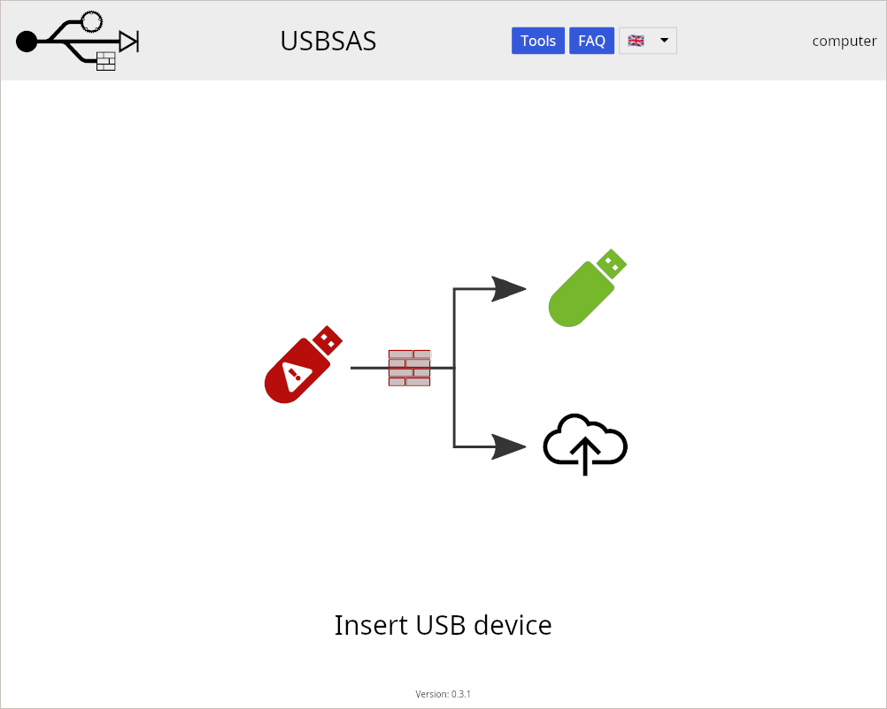

Plug the source device and, if you copy to a USB device, the destination
device. They are listed once detected.

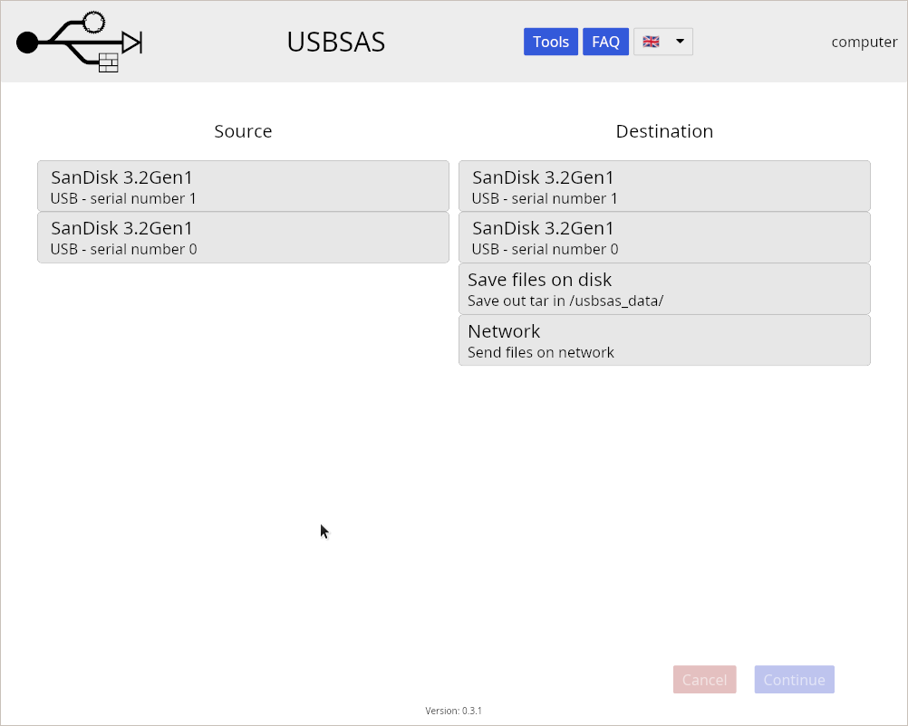

### 2. Choose the source and the destination

Select the device containing your files as the source, and the device (or
network) receiving them as the destination. Double check: the destination is
erased.

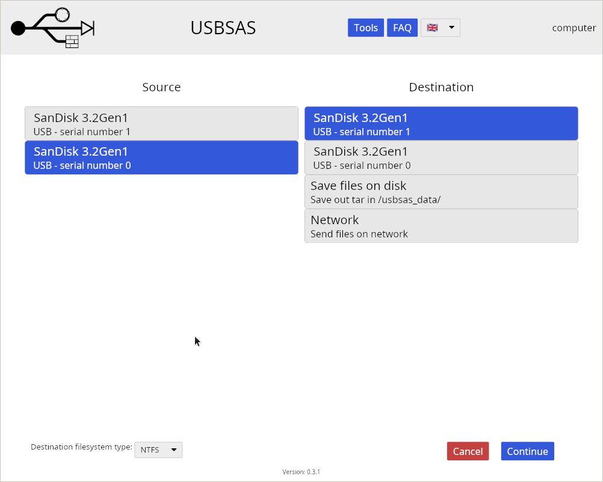

For a USB destination, you can choose the file system it will be formatted with
(NTFS by default). Choose FAT or exFAT if the destination must be read by a
device that doesn't support NTFS (some TVs, cameras, car radios...). FAT can't
store files larger than 4 GB.

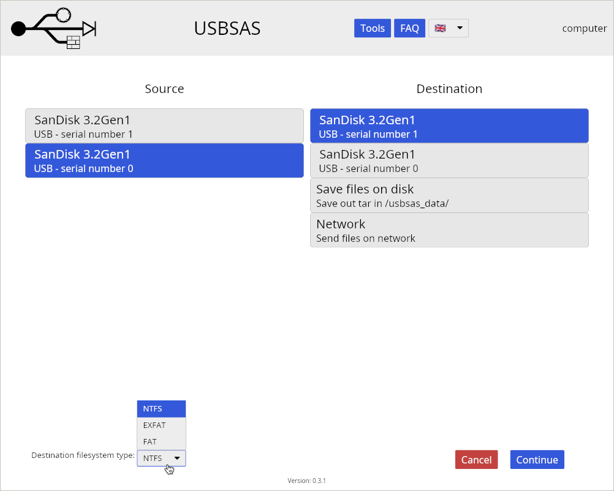

Click **Continue**.

If you are asked to identify yourself, do it as your station requires (badge,
card...). If you chose to download files from a network, enter the export code
you were given.

### 3. Choose the partition

If the source device has several partitions, choose the one containing your
files. If it only has one, this step is skipped.

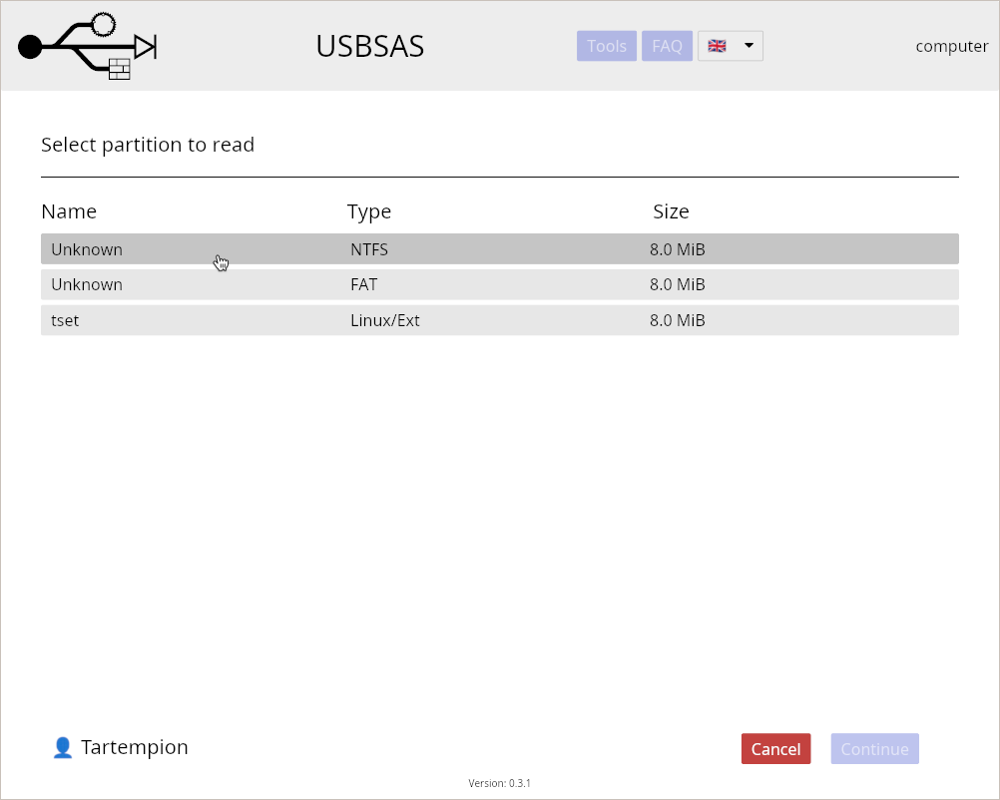

### 4. Select your files

Browse the source device: click a folder to open it, the arrow to go back to
the parent folder. Tick the files and folders to copy; ticking a folder copies
everything it contains. The selected files are listed on the right, click the
bin icon to remove one from the selection.

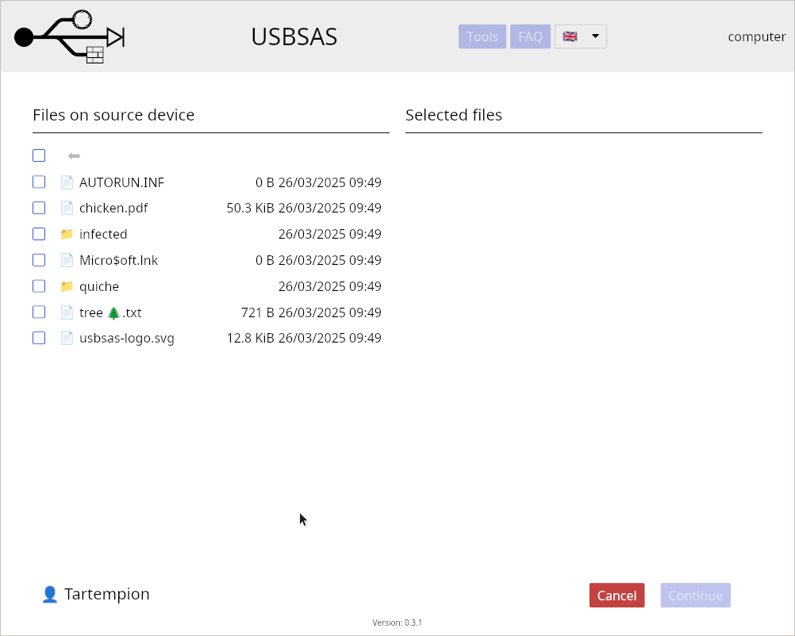

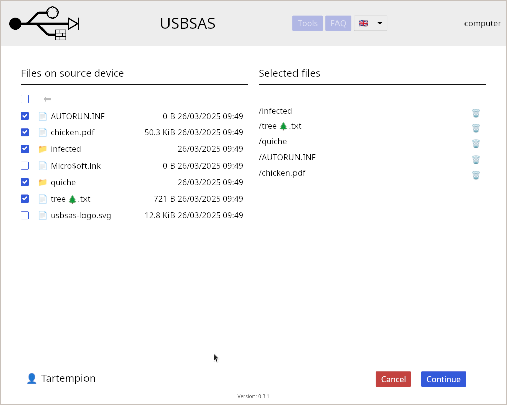

Some folders can be too deep to be opened: a warning is displayed, and their
content isn't copied.

Click **Continue** to start the transfer.

### 5. Wait for the end of the transfer

The station copies the files, has them analyzed if it is configured to, and
writes them to the destination. Each step is displayed with its progress. It
can take a while for large transfers: don't unplug the devices.

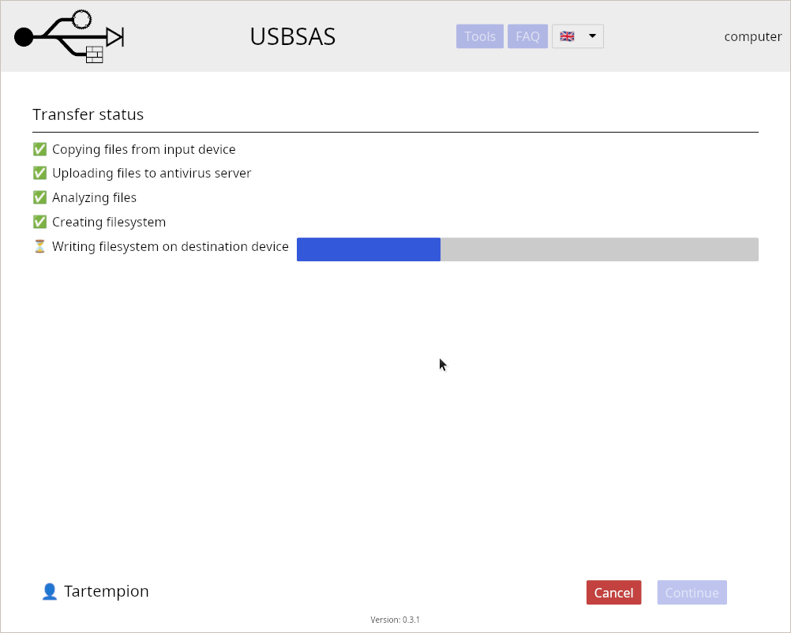

### 6. Check the report and remove your devices

At the end, the report is displayed (see below). Remove your devices, then click
**Reset** to get back to the welcome screen for the next user.

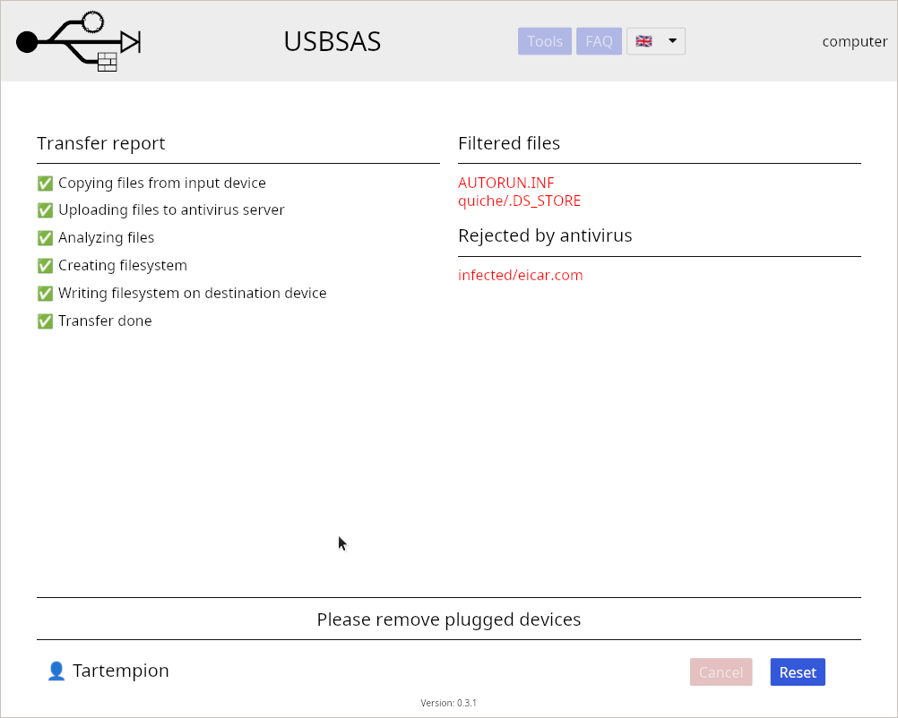

You can click **Cancel** at most steps to stop and start over. Nothing is
written to the destination before the last step of the transfer.

## <a name="report">Transfer report</a>

The report lists the files that were **not** copied, if any:

- **Errors**: files that couldn't be read from the source or written to the
  destination.
- **Filtered files**: files excluded by the rules of the station (system files
  like `thumbs.db` or `autorun.inf`, shortcuts...).
- **Rejected by antivirus**: files the antivirus considered dangerous.
- **Folders whose content wasn't copied**: folders too deep in the directory
  tree.

The report may also be written on the destination device, as a
`usbsas-report-<number>.json` file.

If a file you need was rejected or filtered, contact your administrator, don't
try to copy it another way.

## <a name="tools">Tools</a>

The **Tools** menu offers other operations on a USB device.

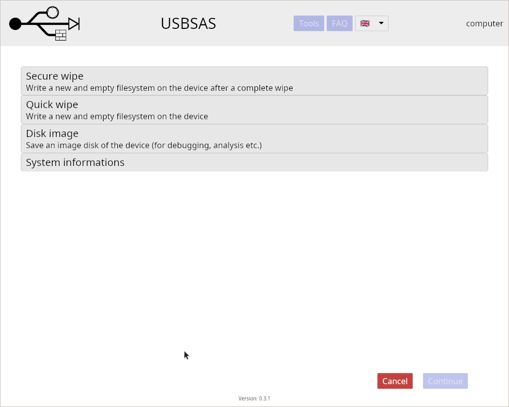

### Wipe a device

Erase a USB device and create a new, empty file system on it (with the file
system chosen at the bottom of the screen):

- **Quick wipe**: only creates the new file system. Old data could still be
  recovered with specialized tools.
- **Secure wipe**: overwrites the whole device before creating the new file
  system. It takes longer.

Select the device to wipe and click **Continue**.

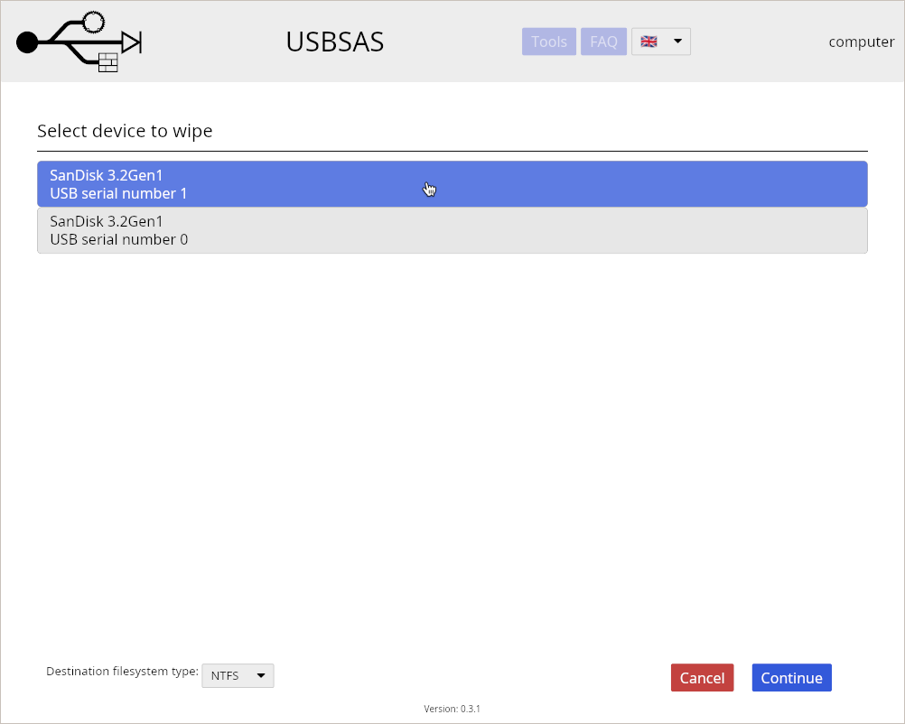

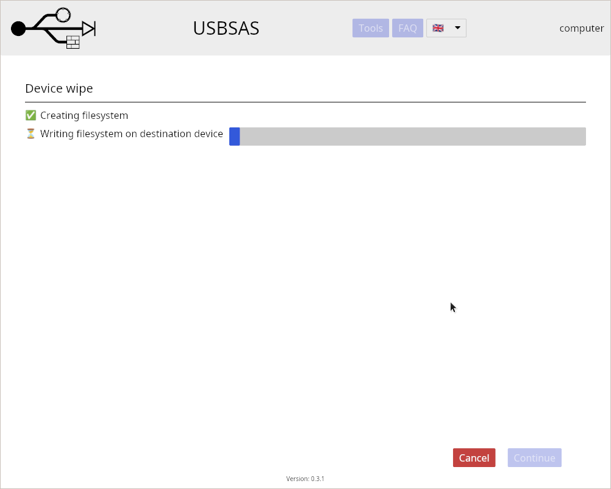

### Disk image

Save a complete copy of a device on the station, for your administrators to
analyze it (for instance if you think the device is infected). Nothing is
written to the device.

### System information

Information about the station, for your administrators.

## <a name="faq">Questions and problems</a>

The **FAQ** button answers the most common questions, and the language of the
interface can be changed from the menu bar.

**My device isn't detected.** Check that it's plugged in an allowed port. Only
USB mass storage devices are supported: phones, cameras or MP3 players
connected in "MTP" mode, for instance, aren't.

**Why not just scan my device with an antivirus?** An antivirus only looks
for known malware in files. A malicious USB device can also attack the computer
it is plugged in (by pretending to be a keyboard, or exploiting the code that
reads devices), or show clean files to the antivirus and other files to your
computer. usbsas protects against these attacks as well, and the files copied
to the destination are exactly the ones that were analyzed.

**An error is displayed.** Click **Reset** and try again. If the error persists,
the source device may be damaged or use an unsupported format: contact your
administrator.
