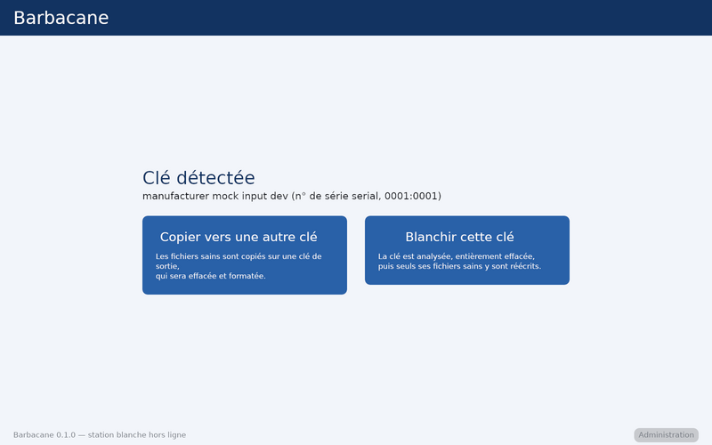

# Utilisation de la borne Barbacane

La borne vérifie une clé USB d'origine inconnue et ne laisse passer que les
fichiers sains. Elle s'utilise **uniquement à la souris**.

## Copier vers une autre clé

1. Branchez la clé à vérifier sur le port **ENTRÉE**.
2. Cliquez **Copier vers une autre clé**.
3. Patientez pendant la lecture et l'analyse. Tous les fichiers sont analysés,
   y compris le contenu des archives (zip, 7z, rar, iso, …).
4. Si une archive est protégée par un mot de passe, saisissez-le avec le
   clavier à l'écran puis **Valider**. **Ignorer cette archive** la refuse.
   Après 3 erreurs, ou sans réponse pendant 5 minutes, l'archive est refusée.
5. Le **résultat** s'affiche : nombre de fichiers sains, fichiers refusés et
   **pourquoi** (menace détectée, archive chiffrée sans mot de passe, archive
   trop volumineuse, etc.).
6. Cliquez **Choisir la clé de sortie**, branchez une clé sur le port
   **SORTIE**. Attention : **son contenu actuel sera entièrement effacé**.
7. Cliquez **Effacer cette clé et y copier les fichiers**. À la fin, retirez les clés.

Sur la clé de sortie :
- les fichiers sains, avec leur arborescence ;
- pour une archive qui contenait un fichier refusé : l'archive n'est pas copiée,
  ses fichiers sains sont dans un dossier `<nom de l'archive>.extrait/` ;
- le rapport `rapport-barbacane-<date>.txt` (et `.html`) : ce qui est passé, ce
  qui a été refusé et pourquoi.

## Blanchir une clé

« Blanchir » nettoie la clé elle-même : elle est analysée, **entièrement
effacée**, puis seuls ses fichiers sains y sont réécrits (avec le rapport).

1. Branchez la clé sur le port **ENTRÉE**, cliquez **Blanchir cette clé**.
2. Après l'analyse et le résumé, cliquez **Blanchir la clé**, puis confirmez.
3. Ne retirez pas la clé avant le message « Terminé ».

Si un message d'erreur apparaît pendant l'écriture : la clé a pu être effacée
sans être réécrite. **Ne l'utilisez pas** ; laissez-la branchée et cliquez
**Réessayer l'écriture** (l'analyse n'est pas refaite).

## Messages fréquents

| Message | Signification |
|---|---|
| menace détectée par ClamAV / YARA : … | le fichier contient un code malveillant connu |
| archive chiffrée : … | archive protégée sans mot de passe valide |
| taux de compression suspect / taille décompressée trop grande / trop de fichiers / archive trop imbriquée | archive anormale (« bombe ») ou trop grande : elle est refusée en entier |
| archive contenant des chemins dangereux | noms de fichiers piégés : l'archive n'est pas copiée, ses fichiers sains sont extraits |
| fichier système écarté | fichier sans intérêt (Thumbs.db, autorun.inf, raccourcis…) |
| Cette clé n'est pas enrôlée | la borne n'accepte que certaines clés de sortie |
| ⚠ Signatures antivirales anciennes | prévenir l'administrateur (mise à jour à faire) |

Aucun fichier de la clé source n'est jamais exécuté ni ouvert par l'ordinateur :
la clé est lue par un programme dédié, sans passer par le système.
